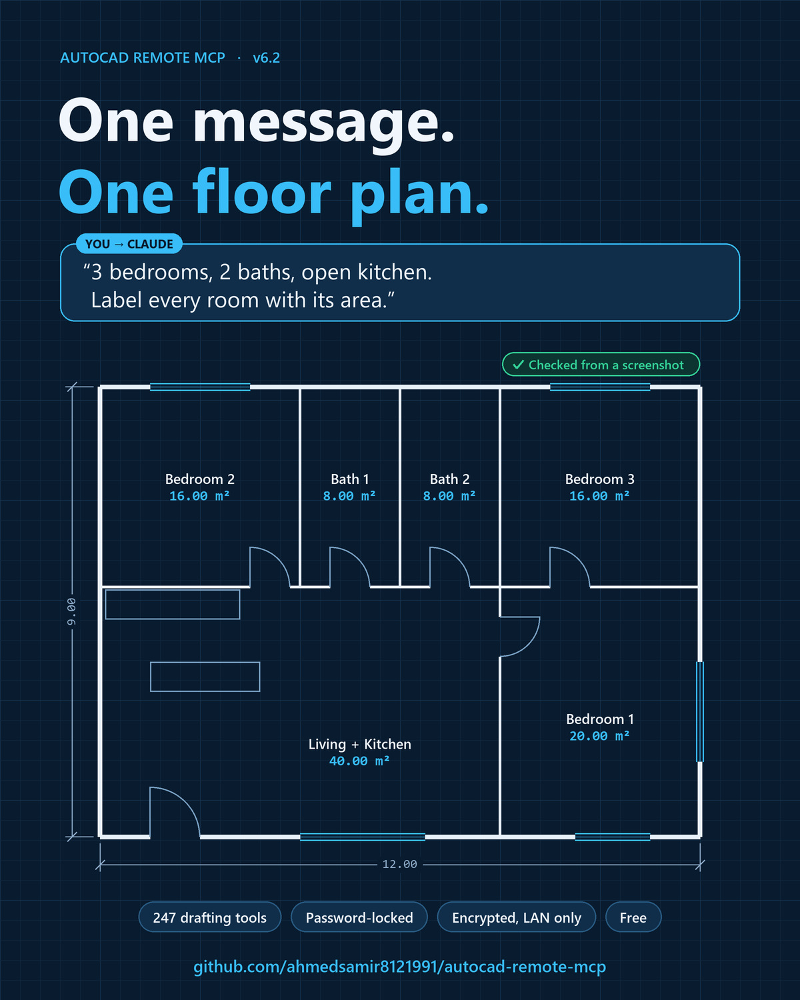

# AutoCAD Remote MCP

**Let Claude drive AutoCAD on another PC on your local network — password-protected, end-to-end encrypted, and locked to safe drawing tools.**


[](https://github.com/ahmedsamir8121991/autocad-remote-mcp/actions/workflows/build.yml)
[](https://github.com/ahmedsamir8121991/autocad-remote-mcp/security/code-scanning)


[](https://github.com/ahmedsamir8121991/autocad-remote-mcp/releases/latest/download/AutoCADRemoteMCP.exe)
&nbsp;
[](https://github.com/ahmedsamir8121991/autocad-remote-mcp/releases/latest)

<p align="center">
  
</p>

AutoCAD Remote MCP is a single Windows executable that connects [Claude](https://claude.ai) (Claude Desktop or Claude Code) to AutoCAD through the [Model Context Protocol](https://modelcontextprotocol.io). Run the same `AutoCADRemoteMCP.exe` on the PC that has AutoCAD and on the PC that has Claude, pair them with a code and your password, and Claude can draw, edit, dimension, measure, check and deliver drawings in plain language.

```
  Claude PC  ──── same Wi-Fi / LAN (encrypted) ────►  AutoCAD PC
  (Claude Desktop / Claude Code)                      (AutoCAD + AutoCAD Remote MCP)
```

Nothing goes over the internet. No accounts, no cloud relay, no router settings.

## First time? Start here

Setup takes about 5 minutes. First, [download AutoCADRemoteMCP.exe](https://github.com/ahmedsamir8121991/autocad-remote-mcp/releases/latest/download/AutoCADRemoteMCP.exe).

> [!IMPORTANT]
> **Keep the black AutoCAD Remote MCP window open the whole time you use AutoCAD with Claude.**
> You can minimize it, but don't close it. If it's closed, Claude can't reach AutoCAD.
> It opens by itself when you log in to Windows and asks for your password.

Pick the setup that matches you:

| | Option A: One PC | Option B: Two PCs |
|---|---|---|
| **You have** | AutoCAD and Claude on the **same** computer | AutoCAD on one computer, Claude on another |
| **Network** | Not needed | Both PCs on the **same** Wi-Fi or office network |

### Option A: One PC (AutoCAD and Claude on the same computer)

1. **Share AutoCAD.** Double-click `AutoCADRemoteMCP.exe` and type `1`.
2. **Choose a password** and type it twice. Write it down: it can't be recovered.
3. **Wait for ONLINE.** The pairing code (`ACAD-…`) is copied for you. **Leave this window open.**
4. **Connect Claude.** Double-click `AutoCADRemoteMCP.exe` **again**. A menu opens: type your password, then type `2`.
5. **Paste the pairing code** (right-click pastes) and type your password.
6. **Restart Claude:** right-click the Claude icon near the clock → **Quit**, then open Claude again.
7. **Open AutoCAD** and ask Claude something (see [Try it](#try-it)).

> [!TIP]
> For the most privacy, open the menu again, choose `7` and pick `P` (**THIS PC only**). Then no other computer can connect.

### Option B: Two PCs (AutoCAD on one, Claude on the other)

Copy `AutoCADRemoteMCP.exe` to both PCs.

**On the AutoCAD PC:**
1. Double-click `AutoCADRemoteMCP.exe` and type `1`.
2. Choose a password and type it twice. Write it down: it can't be recovered.
3. Copy the pairing code (`ACAD-…`). It's copied for you; send it to yourself.
4. Wait for **ONLINE**. **Leave this window open.**
5. If Windows asks about the firewall, tick **Private networks** and click **Allow access**.
6. Open AutoCAD.

**On the Claude PC:**
1. Double-click `AutoCADRemoteMCP.exe` and type `2`.
2. Paste the pairing code (right-click pastes) and type your password.
3. Restart Claude: right-click the Claude icon near the clock → **Quit**, then open Claude again.

### Try it

Put your drawings in `Documents\AutoCAD Remote` on the AutoCAD PC. That's the only folder Claude can open and save in. Then ask Claude:

> Check the AutoCAD status, then draw a 3-bedroom floor plan with 2 baths and an open kitchen, and label every room with its area.

### Every day after that

- Turn on the AutoCAD PC, type your password in the window that opens, and keep that window open.
- Open AutoCAD, then open Claude. Claude asks for your password once the first time it uses AutoCAD.

### If something goes wrong

| Problem | Fix |
|---|---|
| "Windows protected your PC" | Click **More info → Run anyway**. The exe isn't code-signed. |
| Claude says it can't reach AutoCAD | Check that the AutoCAD Remote MCP window is still open and says **ONLINE**. |
| Two PCs still can't connect | Make sure both are on the same network and that Windows shows it as **Private**. |
| Claude doesn't show the AutoCAD tools | Fully quit Claude from the icon near the clock, then open it again. |

More help: [Quick start](#quick-start) · [Troubleshooting](#troubleshooting)

---

## Highlights

- **One exe, two roles** — the same file sets up the AutoCAD PC (server) or the Claude PC (client), and registers the connector in Claude Desktop and Claude Code automatically.
- **Zero-config discovery** — the Claude PC finds the AutoCAD PC on the LAN by itself (signed UDP broadcast).
- **Password + pairing code** — both are required to connect. The password is never stored or transmitted.
- **Encrypted end to end** — every request and reply is signed and encrypted (AES-256-GCM); replays and tampering are refused.
- **Safe mode, always on** — no free-form commands, LISP or scripts; file access limited to one drawings folder; security system variables are read-only.
- **247 tools** — drawing, editing, dimensions (with ISO tolerances and fits), blocks, layers, layouts, 3D solids, P&ID, architectural plans, mechanical parts, takeoffs and delivery packages.
- **Claude can see its work** — screenshots of the AutoCAD drawing area so Claude can check what it drew.
- **Measured verification** — requirements are checked against the actual geometry (target / measured / delta / pass-fail), not assumed.
- **Token-efficient tool search** — only 12 tools are shown up front; Claude finds the rest by AutoCAD command name or plain words.

## What's new in v6.2

- **Toleranced dimensions** — linear, diameter and radius dimensions with ISO 129 tolerances (symmetric ±, deviation, limits, basic) and ISO 286 fits such as `20 H7` or `Ø12 g6`, for shop drawings.
- **Template check** — `template_check` compares the open drawing with your company template (`.dwt` / `.dwg` / `.dws`): layer colour/linetype/lineweight/plot settings, entities on non-standard layers, text styles, dimension styles, linetypes, layouts and blocks. Read-only.
- **Lasting history** — the activity log is saved on the AutoCAD PC (kept 90 days) and survives restarts. Checkpoints are also saved to disk and can be restored as a new drawing even after the PC restarts.
- **One AutoCAD link** — Pro engine tools always act on the same drawing as the rest of the app (no more "active document changed").

<details>
<summary>Earlier releases</summary>

- **v6.1** — Internet mode removed (LAN / this PC only); replies are now encrypted as well as requests; unencrypted requests are refused.
- **v6.0** — Built-in AutoCAD MCP Pro engine (128 extra tools, 247 total) and tool search (`search_tools` / `describe_tool` / `call_tool`).
- **v5.0** — Skills layer: preflight and measured requirement checks, all-or-nothing batches, checkpoints, drawing diff/critique/topology checks, takeoffs, spec-to-drawing workflows and DWG + PDF + manifest delivery.

</details>

## Requirements

| | AutoCAD PC | Claude PC |
|---|---|---|
| OS | Windows 10 / 11 | Windows 10 / 11 |
| Software | Full AutoCAD (uses the AutoCAD COM API — AutoCAD LT is not supported) | Claude Desktop and/or Claude Code |
| Network | Same Wi-Fi / LAN as the Claude PC, network profile set to **Private** | Same network |
| Ports | TCP 8765 (requests), UDP 8766 (discovery) — local only | — |

Python is **not** required on either PC; everything is bundled in the exe.

## Quick start

### 1. On the AutoCAD PC

1. Copy `AutoCADRemoteMCP.exe` to the PC and double-click it.
   *If SmartScreen appears: **More info → Run anyway** (the exe is not code-signed).*
2. Choose **`1` — This PC has AUTOCAD**.
3. Choose a password (8+ characters, 12+ recommended). It cannot be recovered — store it safely.
4. The app installs itself, sets itself to start with Windows, and shows a **pairing code** (`ACAD-…`, also copied to the clipboard).
5. Wait for **ONLINE**. Allow the firewall prompt for *Private networks* if Windows asks. Open AutoCAD as usual.

Put drawings you want Claude to work on in `Documents\AutoCAD Remote` (created automatically), or pick another folder from the menu.

### 2. On the Claude PC

1. Copy the same exe and double-click it.
2. Choose **`2` — This PC has CLAUDE**.
3. Paste the pairing code, then type your password.
4. The connector is added to Claude Desktop (and Claude Code if installed) automatically.
5. Fully quit Claude (tray icon → **Quit**) and reopen it.

### 3. Try it

> Check the AutoCAD status, then draw a 100 × 50 rectangle on a new layer called WALLS in red, and zoom extents.

> Read recipe 'part', then draw a 120 × 80 plate with four 8.5 mm holes 20 mm from the edges, verify it and deliver it as Bracket-A.

## Why you can trust it

| | |
|---|---|
| **Open source** | Every line of the app is in [`src/`](src). Nothing is hidden in the exe that isn't here. |
| **No telemetry, no internet** | No analytics, no update checks, no accounts, no cloud. The only network address in the whole source is the reply from your own AutoCAD PC on your local network ([`launcher.py`](src/launcher.py)). |
| **Verified builds** | Release files are built by GitHub's own machines from this exact code ([build log](https://github.com/ahmedsamir8121991/autocad-remote-mcp/actions/workflows/build.yml)), with a signed build attestation. |
| **Scanned** | GitHub CodeQL checks the code on every change; Dependabot watches every dependency for known vulnerabilities. |
| **Tested** | [`tests/`](tests) checks that wrong passwords, tampered, replayed, unsigned and unencrypted requests are all refused, and that a copied settings file is useless without the password. |
| **Pinned dependencies** | Exact versions in [`requirements-build.txt`](requirements-build.txt); the bundled engine is pinned to one reviewed commit. |

### Check your download yourself

Compare the file's fingerprint with `SHA256SUMS.txt` on the [release page](https://github.com/ahmedsamir8121991/autocad-remote-mcp/releases/latest):

```powershell
Get-FileHash .\AutoCADRemoteMCP.exe -Algorithm SHA256
```

Or prove it was built by GitHub from this repository (needs the free [GitHub CLI](https://cli.github.com)):

```powershell
gh attestation verify .\AutoCADRemoteMCP.exe --repo ahmedsamir8121991/autocad-remote-mcp
```

### What it can never do

- Run free-form AutoCAD commands, AutoLISP, scripts or programs
- Open, save or read files outside the one drawings folder you choose
- Change AutoCAD security settings such as `SECURELOAD` or `TRUSTEDPATHS`
- Connect over the internet, or accept anyone without your pairing code **and** password
- Save or send your password

Windows SmartScreen may still warn the first time because the exe isn't code-signed with a paid certificate. That warning is about the missing certificate, not about anything the app does.

## Security model

| Protection | How |
|---|---|
| Two-factor pairing | Connecting needs the pairing code **and** your password. The code alone is useless. |
| No stored password | The password is never saved or sent. With *Password every start* on (default), only a non-reversible check value is stored; the key is rebuilt in memory from your password each time. With it off, the key is stored encrypted with Windows DPAPI for your user account only. |
| Key derivation | scrypt (N = 32768, r = 8) from password + pairing code. |
| Encryption | AES-256-GCM for every request and reply; each reply is bound to its request. |
| Signing & replay protection | HMAC-SHA256 over time, nonce, method, path and body hash. Requests older than 2 minutes or reusing a nonce are refused. |
| Brute-force lockout | 5 wrong attempts lock that address out for 15 minutes (shown as a `[security]` warning). |
| Local-only network | LAN or this-PC modes only. Discovery answers are accepted only if signed with your key. |
| Password every start | Required to open the app, start sharing, and once per Claude session (3 wrong tries → 1-minute lock). |

## Safe mode (always on)

Even with the code and password — or if Claude follows a bad instruction — the connection can only **draw**, not take over the PC:

- **No free-form commands, LISP or scripts.** Only `regen`, `undo`, `redo`, `audit` and `purge` can be run as commands; everything else goes through dedicated tools.
- **One drawings folder.** Open / save / insert / xref only inside the chosen folder, and only `.dwg`, `.dxf`, `.dwt`. Other folders, network paths, `..\` traversal and junctions are refused.
- **Drafting settings only.** Claude may change everyday variables (`LTSCALE`, `CLAYER`, `OSMODE`, `INSUNITS`, `DIMSCALE`, `TEXTSIZE`, …). Security variables such as `SECURELOAD` and `TRUSTEDPATHS` are read-only.
- **Drawing text is data.** Claude is told never to follow instructions written inside a drawing.
- **Read-only access mode** is available: Claude can only look, measure, search and take screenshots.

## What Claude can do (247 tools)

| Area | Examples |
|---|---|
| Vision | `capture_screenshot`, `view_zoom_and_screenshot` |
| Drawings | new / open / save / switch, `list_drawing_files`, `export_pdf` (model or layout, A4–A0, Letter, Tabloid) |
| Draw | lines, circles, arcs, ellipses, polylines (arcs + width), rectangles, splines, text / MTEXT, leaders, tables, hatches |
| Dimension | aligned, linear, angular, radius, diameter, `dimension_auto`, ISO 129 tolerances, ISO 286 fits |
| Modify | move / copy / rotate / scale, offset, mirror, rectangular & polar arrays, explode, fillet / chamfer / trim / extend / break (lines) |
| Properties & select | change / match properties, select by layer / type / colour / window / text, bounding boxes, find & replace text |
| Layers & styles | create, rename, delete, freeze / lock, isolate, layer states; text, dimension and multileader styles; linetypes |
| Blocks & xrefs | create blocks with attributes, insert with values, edit attributes, attach / list / detach xrefs |
| Layouts & plotting | layouts, viewports, viewport scale / lock, page setups, batch plot, ISO sheet frames, title blocks, revisions |
| 3D | box, cylinder, sphere, cone, wedge, extrude, union / subtract / intersect |
| Measure & quantities | area, distance, polygon, `label_areas`, `quantity_takeoff`, `pipe_takeoff`, `cable_takeoff`, `drawing_scale_check` |
| Architecture | `arch_plan_from_spec`, walls, openings, rooms, stairs, grids, dimension chains, room schedules |
| Mechanical | `mech_part_from_spec`, GD&T frames, datums, surface texture, weld symbols, gears, keyed bores, ISO bolts / nuts / washers / bearings, BOM tables |
| P&ID | `pid_from_spec`, symbol insert, routed process lines, tag parsing, instrument index, equipment list, connection graph |
| Quality & workflow | `drawing_preflight`, `drawing_verify_requirements`, `cad_batch` (all-or-nothing, one undo, dry run), checkpoints, `drawing_diff`, `drawing_critique`, `drawing_topology_check`, `template_check`, `drawing_apply_standard` |
| Delivery | `drawing_finalize` (save + re-measure the reopened file), `drawing_deliver` (DWG + PDF + `manifest.json` with checksums and the requirement report) |
| Discovery | `search_tools`, `describe_tool`, `call_tool`, `system_capabilities`, `recipes` |

Not included on purpose: free-form commands, LISP and scripts. Not yet supported: dynamic blocks, multi-sheet P&ID projects, electrical schematics.

> To expose all 247 tools up front instead of tool search, add `"discovery": "full"` to `%APPDATA%\AutoCADRemoteMCP\server.json` on the AutoCAD PC and restart sharing.

## Menu options

On the AutoCAD PC, double-clicking the exe starts sharing. To open the menu:

```powershell
& "$env:LOCALAPPDATA\AutoCADRemoteMCP\AutoCADRemoteMCP.exe" --setup
```

| # | Option | Notes |
|---|---|---|
| 1 | This PC has AUTOCAD | Set up sharing or show the pairing code (password) |
| 2 | This PC has CLAUDE | Connect with pairing code + password |
| 3 | Change password | Also generates a new pairing code; redo step 2 on every Claude PC |
| 4 | Uninstall | Password required |
| 5 | Drawings folder | The only folder Claude may open / save in; applies immediately |
| 6 | Access mode | FULL or READ-ONLY |
| 7 | Network mode | LOCAL NETWORK or THIS PC only |
| 8 | Password every start | ON (default) or OFF |
| 9 | Exit | |

## Troubleshooting

| Message | Fix |
|---|---|
| *Wrong password or pairing code* | Passwords are case-sensitive. Show the code again with `--setup` → `1` on the AutoCAD PC. |
| *Password rejected* (in Claude) | The password was changed. Run option `2` again on the Claude PC. |
| *Locked for 15 minutes* | Wait, then retry with the correct password. |
| *Cannot reach AutoCAD* | Make sure the AutoCAD PC window shows `[ready] ONLINE`, both PCs are on the same network, and the network profile is **Private**. |
| *Encryption required* | One PC runs v6.0 or older — update both PCs. |
| *AutoCAD is not running on the server PC* | Open AutoCAD. |
| *Files can only be opened/saved inside the drawings folder* | Move the drawing there or change the folder (option `5`). |
| Claude doesn't show the AutoCAD tools | Fully quit Claude from the tray and reopen it. |
| Commands slow or rejected | AutoCAD is busy or stuck at a prompt — ask Claude to run `cancel_command`, or close any open dialog. |
| Antivirus flags the exe | PyInstaller builds are sometimes false positives; allow the file. |

Forgot your password? It cannot be recovered. On the AutoCAD PC delete `%APPDATA%\AutoCADRemoteMCP`, run option `1` again, then redo option `2` on the Claude PC.

## Building from source

Requires Python 3.12, [uv](https://docs.astral.sh/uv/) and a local checkout of the AutoCAD MCP Pro engine.

```powershell
uv venv .venv --python 3.12
uv pip install --python .venv\Scripts\python.exe "C:\autocad-mcp-pro[full]" pyinstaller uvicorn
.\build.ps1
```

Output: `dist\AutoCADRemoteMCP.exe` (single file) plus `README.txt` and the bundled engine licence.

> The build also needs the AutoCAD MCP Pro engine. Clone [U-C4N/Autocad-MCP](https://github.com/U-C4N/Autocad-MCP) to `C:\autocad-mcp-pro`, or change that path in `build.ps1`.

### Project layout

| File | What it does |
|---|---|
| `src/launcher.py` | The exe's entry point: setup menu, password, pairing code, network discovery, Claude config, auto-start |
| `src/acad_server.py` | MCP server and core AutoCAD tools (COM automation), safe mode, request signing and checks |
| `src/acad_crypto.py` | AES-256-GCM encryption of every request and reply |
| `src/acad_skills.py` | Measured workflows: requirement checks, batches, checkpoints, takeoffs, plans, parts, P&ID, delivery |
| `src/acad_pro.py` | Extra drafting tools through COM (no command line, LISP or scripts) |
| `src/acad_bridge.py` | Runs the AutoCAD MCP Pro engine's tools in-process under the same safe-mode rules |
| `src/acad_search.py` | Tool search (`search_tools`, `describe_tool`, `call_tool`) |
| `src/acad_template.py` | `template_check`: compares the open drawing with your company template (read-only) |
| `tests/` | Security, password, encryption, search and end-to-end tests |
| `build.ps1`, `AutoCADRemoteMCP.spec` | PyInstaller build of the single exe |

## File locations

| What | Where |
|---|---|
| Installed exe | `%LOCALAPPDATA%\AutoCADRemoteMCP\` |
| Settings | `%APPDATA%\AutoCADRemoteMCP\` |
| Activity history | `%LOCALAPPDATA%\AutoCADRemoteMCP\history\` (90 days) |
| Auto-start | Startup folder shortcut *AutoCAD Remote MCP* |
| Claude config backups | `*.bak-autocad` next to the original config |

## Feedback

- Found a bug? [Open an issue](https://github.com/ahmedsamir8121991/autocad-remote-mcp/issues/new/choose). Never post your password or pairing code.
- Questions, ideas, or something cool you drew with Claude? Share it in [Discussions](https://github.com/ahmedsamir8121991/autocad-remote-mcp/discussions).
- If this saves you time, a ⭐ helps other AutoCAD users find it.

## License

[MIT](LICENSE). The bundled AutoCAD MCP Pro engine is also MIT-licensed (see below).

## Credits

Includes the **AutoCAD MCP Pro** engine ([U-C4N/Autocad-MCP](https://github.com/U-C4N/Autocad-MCP), MIT licence — see `LICENSE-AutoCAD-MCP-Pro.txt`), run under the same safe-mode rules.

AutoCAD is a registered trademark of Autodesk, Inc. This project is not affiliated with or endorsed by Autodesk or Anthropic.
